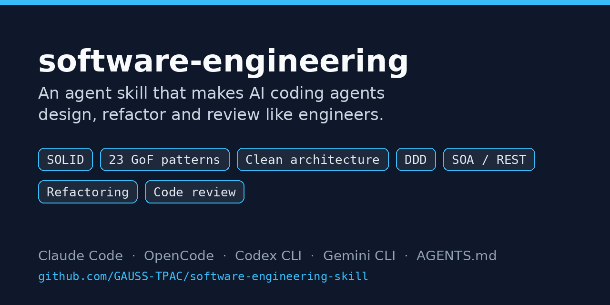

# software-engineering-skill



[](LICENSE)
[](https://github.com/GAUSS-TPAC/software-engineering-skill/releases)


An [Agent Skill](https://agentskills.io) that makes AI coding agents design, write, refactor and review code like a disciplined software engineer.

Works with **Claude Code**, **OpenCode**, **Codex CLI**, **Gemini CLI**, and any agent that reads `AGENTS.md` (Cursor, Aider, Copilot…).

## Quick install

```bash
git clone --depth 1 https://github.com/GAUSS-TPAC/software-engineering-skill.git ~/.software-engineering-skill \
  && ~/.software-engineering-skill/install.sh --link
```

Installs the skill for every supported agent. Thanks to `--link`, a later `git -C ~/.software-engineering-skill pull` updates it everywhere.

## Example

> **Prompt:** "Every new notification channel means editing this function. Refactor it."

**Before**
```java
void send(String channel, User u, String msg) {
  if (channel.equals("EMAIL")) { smtp.send(u.email(), msg); }
  else if (channel.equals("SMS")) { sms.send(u.phone(), msg.substring(0, 160)); }
  else if (channel.equals("PUSH")) { fcm.push(u.deviceToken(), msg); }
  else throw new IllegalArgumentException(channel);
}
```

**What the agent does with the skill**
1. Names the smell: a *Switch Statement* on a type, which violates **OCP** (each new channel edits existing code).
2. Picks the pattern from the problem → pattern table: interchangeable algorithms chosen at runtime → **Strategy**, with channels registered through **dependency injection**.
3. Refactors in small steps, behavior unchanged, and adds a test per channel.

**After**
```java
interface NotificationChannel {
  String id();
  void send(User u, String msg);
}

final class SmsChannel implements NotificationChannel {
  public String id() { return "SMS"; }
  public void send(User u, String msg) { sms.send(u.phone(), truncate(msg, 160)); }
}
// EmailChannel, PushChannel…

final class Notifier {
  private final Map<String, NotificationChannel> channels;
  Notifier(List<NotificationChannel> all) {
    channels = all.stream().collect(toMap(NotificationChannel::id, c -> c));
  }
  void send(String channel, User u, String msg) {
    var c = channels.get(channel);
    if (c == null) throw new IllegalArgumentException("Unknown channel: " + channel);
    c.send(u, msg);
  }
}
```
Adding WhatsApp now means adding one class. `Notifier` never changes.

It also knows when **not** to do this: with only two stable channels and no new ones planned, it keeps the `if` (YAGNI).

## What it does

Once installed, the agent picks the right working mode (design, implementation, review, refactoring or teaching) and follows a method:

- **Find what varies** before designing, and keep likely changes local.
- **Apply the principles**: SOLID, GRASP, DRY, KISS, YAGNI, Law of Demeter, composition over inheritance.
- **Pick a design pattern only when a real problem justifies it**, using a "problem → pattern" table covering all 23 GoF patterns, with guardrails against over-engineering.
- **Structure the architecture**: layers, hexagonal / clean architecture, DDD, modular monolith or microservices, REST and service contracts.
- **Review code** with a checklist and severity-ranked findings (violated principle, breaking scenario, fix).
- **Refactor safely**: code smell → refactoring → target pattern, in small tested steps.
- **Explain concepts** like a course, with exam-style answers.

## Contents

```
software-engineering/
├── SKILL.md                      method, principles, problem → pattern table, deliverables
└── references/                   loaded on demand (progressive disclosure)
    ├── principles.md             software qualities, cohesion and coupling, SOLID, OO principles, GRASP
    ├── gof-patterns.md           23 GoF patterns, concurrency patterns, confusions, language idioms
    ├── architecture.md           styles, hexagonal, enterprise patterns, DDD, microservices, resilience, MDA, ADR
    ├── components-services.md    CBSE, component models, EJB, UML, SOA, SOAP/WSDL, BPEL, REST
    ├── smells-refactoring.md     code smells, anti-patterns, safe refactoring, technical debt
    ├── testing-quality.md        V&V, test pyramid, TDD, test doubles, metrics, CI/CD, Docker
    ├── review-checklist.md       review checklist and report format
    └── course-notes.md           definitions and exam-style answers
```

## Installation

```bash
git clone https://github.com/GAUSS-TPAC/software-engineering-skill.git
cd software-engineering-skill
./install.sh
```

Options:

```bash
./install.sh claude opencode        # only some agents
./install.sh --link                 # symlinks: edits to the repo apply everywhere
./install.sh --project ~/my-project # into a project, plus a section in its AGENTS.md
./install.sh --uninstall            # remove
```

| Agent | Global folder | Project folder |
|---|---|---|
| Claude Code | `~/.claude/skills/` | `.claude/skills/` |
| OpenCode | `~/.config/opencode/skills/` (also reads `~/.claude/skills/`) | `.opencode/skills/` |
| Codex CLI | `~/.codex/skills/`, `~/.agents/skills/` | `.agents/skills/` |
| Gemini CLI | `~/.gemini/skills/` | `.gemini/skills/` |
| Cursor, Aider, Copilot… | — | `AGENTS.md` section pointing to `.agents/skills/` |

Manual install: copy the `software-engineering/` folder into your agent's `skills/` folder.

## Usage

The skill triggers automatically when a request is about design, architecture, patterns, refactoring or review. You can also call it explicitly:

- Claude Code: `/software-engineering design the payment module`
- Other agents: "use the software-engineering skill to review this code".

Examples:

- "Design order management for a cafeteria, with extras and order states."
- "Review `src/services/` against SOLID."
- "This `switch` on account type grows every sprint: refactor it."
- "Explain orchestration vs choreography, exam style."

Tip: give the agent context ("more payment methods are coming soon", "single team", "it's a school project"). It designs better when it knows what will actually change.

## Sources

Built from a university Software Engineering course (ENSPY, Yaoundé, Cameroon) and the classics: Sommerville's *Software Engineering*, *Design Patterns* (Gamma, Helm, Johnson, Vlissides), *Head First Design Patterns*, Robert C. Martin (SOLID, Clean Architecture), Craig Larman (GRASP), Eric Evans (DDD), Martin Fowler (*Refactoring*, *Patterns of Enterprise Application Architecture*), Szyperski (*Component Software*), Thomas Erl (SOA).

## Contributing

Issues and pull requests are welcome: corrections, new examples, more language idioms, translations.

## License

[MIT](LICENSE)
