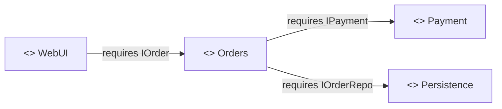

# Components (CBSE) and services (SOA, Web services, REST)

## Contents
1. Objects, components, services: comparison
2. CBSE: definitions, characteristics, process
3. Interfaces, composition, incompatibilities and adapters
4. Component models and middleware
5. EJB
6. Components in UML
7. SOA and Web services (SOAP, WSDL, UDDI)
8. Service composition: workflow, orchestration, choreography, BPEL
9. REST and HTTP
10. Testing services
11. Practical rules for the agent

---

## 1. Objects, components, services

Common traits: **abstraction** and **encapsulation**.

| | Objects | Components | Services |
|---|---|---|---|
| Location | Same process | Different processes, same environment | Different environments |
| Mechanisms | Inheritance, polymorphism | Provided **and required** interfaces, runtime infrastructure (container) | Emphasis on interface, contract and service agreement (SLA); dynamic discovery |
| Deployment | Inside the application | At the **consumer's** premises | At the **producer's** premises |
| Communication | Method call | Call through middleware (RMI, IIOP) | Messages (XML/SOAP, JSON/HTTP) |
| Composition | Static | At assembly time | Dynamic, at runtime |

History of reused entities: functions (1960s) → modules (1970s) → objects (1980s) → components (1990s; McIlroy 1968 "Mass Produced Software Components", Szyperski 1998) → services (2000s) → models (2010s, MDE).

## 2. CBSE (Component-Based Software Engineering)

**Definitions**
- *Szyperski*: a software component is a unit of composition with contractually specified interfaces and explicit context dependencies only. It can be deployed independently and is subject to composition by third parties.
- *Councill and Heineman*: a software element that conforms to a component model and can be independently deployed and composed without modification according to a composition standard.
- A component is an independent unit of **development, storage and distribution**, an abstraction above functions and objects.

**Component or library.** A library is static, not autonomous, and bound at compile time. A component is autonomous, executable, deployable, composed at assembly or runtime, and declares its required interfaces.

**Motivations**: development speed; reuse beyond libraries; integration and stepwise migration; bringing developers closer to the domain; platform heterogeneity; separation of interface and implementation.

**Characteristics**: part of a whole (composable, decomposable); **ecosystem** (collaborating components, component framework, component model); **component framework** (the "printed circuit board" on which they are assembled); **component model** (defines what a component is, how it is built, composed and deployed); provided and required interfaces; compatibility; implementation independence.

**Object technology is neither necessary nor sufficient for CBSE.** It was a convenient starting point, but it does not express all the abstractions CBSE needs (insufficiency), and CBSE can be done without objects, e.g. with a function library exposed through an API (non-necessity). CBSE emerged from OO's failure to support effective reuse: classes are too fine-grained and too specific.

**CBSE essentials**: independent components specified by their interfaces; component standards (the model); middleware for interoperability; a reuse-oriented process.
**Design principles**: independent components that don't interfere; hidden implementations; communication through well-defined interfaces; shared platforms that reduce costs.
**Benefits**: reuse (development = assembly); flexibility (maintenance by replacement, extension by addition, possibly at runtime).
**Problems**: trustworthiness (no source code), certification, predicting emergent properties, trade-offs between requirements and available components.

**CBSE process**: outline requirements → search for components → **modify requirements** based on what exists → revise the architecture → search again → compose. Trade-offs between ideal requirements and available services are unavoidable.
**Roles**: business executive, business analyst (domain model, use cases), architect (component specifications, architecture, asset repository), component developer, assembler, tester, deployer.
**Component identification**: trust in the supplier, fit with requirements, validation (insufficient specification, unwanted functionality).
**Categories**: custom components, internally reused components, commercial components (COTS).

## 3. Interfaces, composition and adapters

- **Provided interface** (*provides*): services offered to others. **Required interface** (*requires*): services the component expects from its environment.
- **Compatibility**: one component's provided interface matches the other's required interface.
- **Composition types**:
  - **sequential**: components run in sequence and their provided interfaces are composed (with glue code);
  - **hierarchical**: A calls B's services, A's required interface being composed with B's provided interface;
  - **additive**: the interfaces of two components are put together to form a new component.
- **Incompatibilities**:
  - **parameter**: same operation name, different types;
  - **operation**: different operation names;
  - **incompleteness**: the provided interface is a subset of the required interface.
- **Solution**: an **adapter component** (Adapter pattern) that reconciles the interfaces. Classic example: `addressFinder` and `mapper`, where the adapter extracts the postal code from the address and passes it to `mapper`.
- **From compile-time coupling to automated assembly** (the `AgeCalculator` example):
  1. a `.jar` on the classpath, hence tight compile-time coupling;
  2. a separate interface (`AgeCalculatorIfce.jar`) that breaks the compile-time dependency;
  3. manual **glue code** wiring the implementation and the client (that is manual dependency injection);
  4. a **component framework** (EJB container and **JNDI** registry: the provider publishes, the client looks up) that automates assembly. Today: DI containers (Spring, CDI, Guice, Dagger, `get_it`).

**Takeaway for the agent**: each module or package should expose a minimal public interface (provided), declare its dependencies as injected interfaces (required), and a single place (composition root, DI configuration) wires everything together.

## 4. Component models and middleware

**Elements of a component model**: interfaces (definition, specific interfaces, composition), usage information (naming convention, metadata access, customization), deployment and use (packaging, documentation, evolution support).
**Middleware services**: platform services (communication, naming) and **horizontal** application-independent services (transactions, security, persistence, concurrency, lifecycle). Components are deployed in a **container**.

**Comparison table**

| | Java (Sun/Oracle) | Microsoft | OMG (CORBA) | Web services |
|---|---|---|---|---|
| Basic component | JavaBeans | COM | CORBA objects | Service |
| Distribution (middleware) | RMI (RMI-IIOP) | DCOM, .NET Remoting, WCF | ORB and IIOP | SOAP over HTTP |
| Enterprise services | EJB / J2EE / Jakarta EE | COM+, .NET Enterprise Services | CORBA Services, CCM | WS-* (Security, Transaction, BPEL) |
| IDL | Java interfaces | MIDL (COM IDL) | CORBA IDL | WSDL |
| Naming, directory | JNDI | Windows Registry, Active Directory | Naming Service | UDDI |
| Transactions | JTA | MTS / DTC | OTS | WS-AtomicTransaction |
| Languages | Java | Multi-language (C++, C#, VB) | Multi-language | Independent |

**Other models**: OSGi (dynamic Java bundles and services), Fractal (modular, extensible, reflective, multi-language), SOFA 2 (defined by a metamodel), XPCOM (Mozilla, cross-platform, inspired by COM and CORBA), CCM, .NET assemblies.
**Middleware types**: message-oriented, MOM (JMS, RabbitMQ, Kafka); RPC; object-oriented (Java RMI, CORBA, DCOM, .NET Remoting).

## 5. EJB (Enterprise JavaBeans)

- **Definition**: a **server-side** component architecture following a specification. EJBs run inside an **EJB container** (application server: GlassFish, WildFly, WebLogic) in a 3-tier or n-tier architecture. Developers focus on business logic; the container provides transactions, security, concurrency, lifecycle, pooling and naming.
- **Structure (EJB 2.x)**: *Remote* or *Local* interface (business services), *Home* interface (lifecycle: create, find), bean class. **Since EJB 3.x**: a plain annotated POJO (`@Stateless`, `@Stateful`, `@Singleton`, `@Local`, `@Remote`); the Home interface is gone.
- **Types**:
  - **Session beans**: *stateless* (no conversational state, pooled, shared among clients), *stateful* (conversational state tied to **one** client, like a shopping cart), *singleton* (one instance per application, with concurrency management).
  - **Message-Driven Beans**: react asynchronously to messages from a MOM (JMS), with no client interface.
  - **Entity beans** (CMP or BMP), **replaced by JPA entities** (`@Entity`, `EntityManager`) since EJB 3.
- **Structural and behavioral differences**: a stateless bean has no conversational field and each call is independent; a stateful bean keeps state between calls, can be passivated or activated and ends with `@Remove`; an MDB has no interface and implements `MessageListener.onMessage`.
- **Deployment**: EJB module in a `.jar` (optional descriptor `META-INF/ejb-jar.xml`), web module in a `.war` (`WEB-INF/web.xml`), enterprise application in an `.ear` bundling both.
- **Communication**: local call (same JVM, by reference); remote via **RMI-IIOP** (by value, serialization); asynchronous via **JMS** (MDB); **JNDI** lookup or `@EJB` injection. A stateless session bean can be exposed as a Web service (`@WebService`, JAX-WS).

## 6. Components in UML

- A component is drawn as a rectangle stereotyped `<<component>>` (or `<<subsystem>>`), with an optional icon.
- Provided interface: the **ball** (lollipop). Required interface: the **socket**. There is also a stereotype notation `<<interface>>` with realization and dependency, and a textual list notation (with an `<<artifacts>>` section).
- **Port**: a component's interaction point with the outside, grouping interfaces.
- **Assembly connector**: links a required interface to a provided interface. **Delegation connector**: links an external port to an internal part.
- **Black-box view** (interfaces only) or **white-box view** (internal parts and realizing classes).
- Composite structure: parts, connectors, ports, collaborations (to depict a pattern).

Mermaid example:

## 7. SOA and Web services

- **Service**: a program that makes its functionality available through a published API that is part of a **service contract**. The service is independent of the application using it. A loosely coupled, reusable component encapsulating discrete functionality, programmatically accessible.
- **Critical difference with a component**: services are **independent**. They have **no required interface** and communicate through **messages** rather than method calls.
- **SOA**: a way to build distributed systems whose components are autonomous services, on different machines and providers, platform- and language-independent, discoverable through registries.
- **The SOA triangle**: the **provider** publishes to the **registry**, the **requester** searches the registry, then **binds** to the provider and invokes it.
- **Service design principles (Thomas Erl)**: standardized contract, loose coupling, abstraction, reusability, autonomy, statelessness, discoverability, composability.
- **Benefits of services**: provider independence, public advertising of availability, runtime binding, opportunistic composition, pay per use, smaller, reactive and adaptive applications. **Benefits of SOA**: services provided locally or outsourced, language independence, legacy investment preserved, easier cross-organization information exchange.
- **Contemporary SOA**: activities, coordination, atomic transactions, long-running business activities, orchestration, choreography.
- **Misconceptions (Erl)**: "an application that uses Web services is service-oriented"; "SOA is just a marketing term to rebrand Web services".
- **Service types**: utility (cross-cutting), business, coordination (process).
- **Service engineering** (development *for* reuse): candidate service identification, interface design, implementation, testing, deployment. **Development with services** (development *with* reuse): a client consumes a service, or several services are composed.

**Web service (W3C definition)**: an application identified by a URI, whose interfaces and bindings can be defined, described and discovered as XML artifacts, and which interacts directly with other applications through XML messages over Internet protocols.

**Standards stack**: transport (HTTP, HTTPS, SMTP) → messaging (**SOAP**) → description (**WSDL**, **UDDI**) → process (**WS-BPEL**) → support (WS-Security, WS-Addressing, WS-ReliableMessaging, WS-Transaction); XML and XSD everywhere. Bodies: **W3C** (XML, XSD, SOAP, WSDL) and **OASIS** (UDDI, WS-BPEL, WS-Security).

- **SOAP**: `Envelope` (mandatory) → `Header` (optional: authentication, session, routing) → `Body` (mandatory: operation and parameters, or a `Fault` on error).
- **WSDL** (an XML IDL): the **what** (operations and messages), the **how** (binding to a protocol) and the **where** (URI). Abstract part: `types`, `message`, `portType` (called `interface` in WSDL 2.0), `operation`. Concrete part: `binding` (rpc or document style, transport), `port` (called `endpoint` in 2.0), `service`.
- **WSDL operation types**: one-way (receives without replying), request-response, solicit-response (the service sends and waits for a reply), notification (the service sends without waiting).
- **Approaches**: *bottom-up* (code then generate the WSDL: `java2wsdl`, `wsgen`) or *top-down / contract-first* (WSDL then generate stubs: `wsdl2java`, `wsimport`).
- **Client side**: generated stubs (the Service Endpoint Interface is known at compile time), dynamic proxy (obtained at runtime), **DII** (Dynamic Invocation Interface: operation and URL given at runtime, very flexible but verbose).
- **Binding**: static (fixed URL), dynamic by reference (URL given at runtime), dynamic by registry lookup, dynamic operation selection.
- **Java APIs**: JAX-WS (formerly JAX-RPC), SAAJ, JWSDL, JAXR.
- **UDDI**: a directory standard. Public registries disappeared around 2008: complex standard, no semantics, no certification or trust, content invisible to search engines.
- **Distributed objects (CORBA, RMI) or SOA**: within or between enterprises; language-bound or independent; procedural or message-oriented; one fixed transport or several; efficient or less efficient.
- **Web application or Web services**: human-to-program or program-to-program interaction; static or dynamic integration; monolithic or service aggregation.

**"Is SOA a reality or just a slogan?"** An argued answer:
- *Reality*: mature standards (WSDL, SOAP, BPEL), massive adoption in banking, telecoms and government, ESBs in production, and microservices and REST APIs extending its principles (contract, loose coupling, autonomy, composability).
- *Slogan*: many "SOA" projects were just Web services bolted onto legacy, without governance or real reuse; the failure of public UDDI; the heaviness of WS-*; vendor marketing.
- *Conclusion*: SOA is a reality **as an architectural principle**; it was a slogan **as a product being sold**. Its ideas live on under other names: microservices, APIs, event-driven.

## 8. Service composition

- **Option 1**: composition coded in a regular language, the application invoking the services. **Option 2**: a composition model (workflow) executed by the platform.
- **Workflow**: the automation of all or part of a business process, during which documents, information or tasks pass from one participant (human or machine) to another according to rules. A WfMS defines, schedules and dispatches activities and passes data between them.
- **Programming in the large** (flows composed by non-programmers) versus **in the small** (fine-grained functions written by programmers).
- **Workflow patterns** (van der Aalst): sequence, parallel split, synchronization, exclusive choice, multi-choice, merge, discriminator, multiple instances, deferred choice, milestone, cancellation, loops, triggers.
- **Orchestration**: centralized; one organization owns and controls the composition logic; services don't know each other (executable BPEL). **Choreography**: decentralized, no single owner of the logic; participants know each other and follow shared message-exchange rules (WS-CDL, or today, events).
- **Process modeling**: Petri nets (places, transitions, arcs, tokens), UML activity diagrams, YAWL, **BPMN** (flow objects, connecting objects, swimlanes, artifacts), translated to BPEL.
- **WS-BPEL** (BPEL4WS in 2002 by IBM, Microsoft and BEA; OASIS WS-BPEL 2.0 in 2007; successor of WSFL and XLANG; XML-based, no standard graphical notation). A process is itself exposed as a Web service, enabling recursive composition. Its elements:
  - `partnerLinks` (interactions with partners, with their roles and portTypes), `variables`, `correlationSets` (route each message to the right process instance, e.g. an order number), `faultHandlers`, `compensationHandlers` (undo the effects of an already executed step), `eventHandlers`;
  - primitive activities: `invoke`, `receive`, `reply`, `wait`, `assign`, `throw`, `terminate`, `empty`;
  - structured activities: `sequence`, `flow` (parallel), `switch` (`if` in 2.0), `while`, `pick`.
  - **Executable** process (an orchestration) or **abstract** process (a specification of exchanges, close to a choreography).
  - **Pros**: portable, partners bound at runtime, inline data transformations. **Cons**: static composition, partners defined at design time, no semantics or runtime discovery, long and unreadable XML.
- **Today**: workflow engines (Camunda, Temporal, AWS Step Functions), sagas, event-based choreography (Kafka).

## 9. REST and HTTP

- **HTTP**: client-server, **stateless** (sessions through cookies or tokens), extensible through headers, built on TCP (HTTP/3 on QUIC and UDP). A request holds method, path, version, headers and an optional body; a response, version, status code, message, headers and body.
- **Methods**: `GET` (read; safe, idempotent), `POST` (create or action; neither safe nor idempotent), `PUT` (full replacement; idempotent), `PATCH` (partial update), `DELETE` (removal; idempotent), `HEAD`, `OPTIONS`.
- **Status codes**: 1xx (informational), 2xx (success: 200, 201 Created with `Location`, 204 No Content), 3xx (redirection: 301, 304), 4xx (client error: 400, 401 unauthenticated, 403 forbidden, 404, 409 conflict, 422 unprocessable entity, 429 too many requests), 5xx (server error: 500, 502, 503, 504).
- **REST constraints (Fielding, 2000)**: client-server, stateless, cacheable, **uniform interface** (resources identified by URI, manipulation through representations, self-descriptive messages, **HATEOAS**), layered system, code on demand (optional).
- **Richardson Maturity Model**: level 0 (one endpoint, RPC over HTTP), 1 (resources), 2 (HTTP verbs and codes), 3 (hypermedia).
- **API best practices**: plural nouns (`/orders/{id}/lines`), not verbs; filtering, sorting and pagination through query parameters; versioning (`/v1` or a header); standard errors (RFC 9457, *problem+json*); idempotency keys for `POST`; input validation; **contract-first** with OpenAPI; DTOs separate from entities; OAuth2 or JWT authentication; rate limiting; controlled CORS.
- **REST or SOAP**: lightweight resources and representations (JSON) over HTTP, or operations in an XML envelope with a strict WSDL contract and WS-* (security, transactions). Other options: **gRPC** (protobuf contract, performance, streaming), **GraphQL** (client-shaped queries), **asynchronous messaging** (AsyncAPI, Kafka, AMQP).

## 10. Testing services

Difficulties: external services are **black boxes** (no source-based testing); the provider may change the service and invalidate tests; dynamic binding changes the service actually used; non-functional behavior depends on load; calls may be paid; compensating actions are hard to trigger.
Answers: **contract tests** (Pact, Spring Cloud Contract), simulators and test doubles (WireMock, MockServer), isolated environments (Testcontainers), load testing, *chaos engineering*, synthetic monitoring in production. Manual tools: Postman, curl, webhook.site.

## 11. Practical rules for the agent

- Every module or service boundary goes through an **explicit contract**: an interface, OpenAPI, protobuf or WSDL.
- Never expose persistence entities through an API: use DTOs.
- An external service client hides behind a **port** (a domain interface) and an **adapter**, with timeouts, retries on idempotent operations, circuit breaker and error handling.
- Components communicate through their public interfaces. No direct access to another module's or service's database.
- Wiring (DI) is concentrated in a **composition root**.
